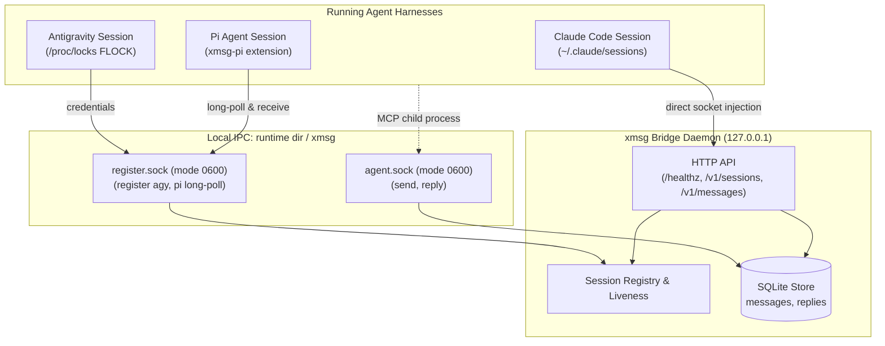

# xmsg: Local Inter-Agent Messaging & Coordination Bridge

`xmsg` is a fast, lightweight local messaging bridge connecting running AI agent sessions across harnesses (Claude Code, Antigravity, and Pi) on the local host. It provides direct, zero-overhead inbox delivery, attested caller identification, persistent reply threading, and MCP tooling.

---

## 1. Security Architecture & Trust Model

### 1.1 Same-UID Trust Boundary

All local IPC in `xmsg` relies on Unix domain sockets located in `$XDG_RUNTIME_DIR/xmsg/` (`http.sock`, `agent.sock`, `register.sock` in mode `0700` directory, socket mode `0600`, owned by the running user's UID). On macOS, when `XDG_RUNTIME_DIR` is unset, the runtime dir is the per-user Darwin temp dir (`getconf DARWIN_USER_TEMP_DIR`, also a `0700` directory):

- Sockets authenticate connected peers via kernel-attested credentials (`SO_PEERCRED` on Linux, `getpeereid` and `LOCAL_PEEREPID` on macOS). On macOS the peer PID is the last process to use the socket, not the one that connected as with `SO_PEERCRED`; they differ only when a connected socket is shared between processes before `accept`, and the UID check is unaffected.
- Any process executing under the **same local UID** is within the trust boundary and may connect to the Unix sockets.
- Sockets are protected against symlink attacks and race conditions on startup by verifying directory ownership and permissions prior to binding.
- All HTTP API endpoints are exposed over `$XDG_RUNTIME_DIR/xmsg/http.sock` by default. Every connection undergoes a peer UID check (`peer_uid == server_uid`) before HTTP framing, dropping connections from other UIDs immediately.

### 1.2 No-Authentication HTTP Posture & Unix-Socket Default

> [!WARNING]
> **No-Auth HTTP Service**: The `xmsg` HTTP server provides **no application-level authentication mechanisms**. It relies on Unix domain socket peer credentials (`SO_PEERCRED` / `getpeereid`) for access control.
>
> By default, `xmsg serve` binds **no TCP port whatsoever**. It listens solely on the local Unix domain socket `$XDG_RUNTIME_DIR/xmsg/http.sock`.
>
> A TCP loopback listener is available **only** when explicitly requested via the `--listen <IP:PORT>` CLI flag or `XMSG_LISTEN` environment variable. This is intended strictly for clients that explicitly configure `XMSG_URL` or for container / Kubernetes pod environments where loopback is an isolated, private network namespace. Never bind TCP to external or shared interfaces.

### 1.3 Attestation & Identity Derivation

`xmsg` prevents cross-session and cross-harness impersonation among non-adversarial same-UID processes:

- **Claude Sessions:** Discovered via configured session directories (defaulting to `~/.claude/sessions`). In multi-tenant setups (such as `genie` running one `CLAUDE_CONFIG_DIR` per subscription token, where each user has separate session directories), `xmsg` accepts multiple session directories via repeatable `--sessions-dir` flags or colon-separated paths in `XMSG_SESSIONS_DIR`. Process liveness and starttime continuity are verified via `/proc/<pid>/stat` (on macOS via `proc_pidinfo`, matching to the second the UTC `ps -o lstart` text Claude Code records as `procStart`; local-time renderings are rejected). When multiple live processes present the same conversation ID `X` (whether in the same session directory or across multiple tenant directories), they are managed via the SQLite persistent claim table (`instance_claims`). The first live process presenting `X` receives plain `X` (suffix 1); subsequent live processes receive monotonic suffixes `X~2`, `X~3`, ... in observation order, broken by `(procStart, pid)` within the same scan. Suffixes are persistent across server restarts and are never promoted while live. When a process exits or `<pid>.json` stops naming the ID, the claim is released. If plain `X` is released, a newly observed process can claim it; previously used numeric suffixes are never reused while records exist. When a node observes a second live process for an already-live ID, it sends exactly one fork notice to each process informing them of both addresses and routing.
- **Antigravity Sessions:** Verified via dual attestation: the registering peer's ancestor chain is traversed to find a process matching a configured trusted executable (`--agy-exe`) that has the presence lock file descriptor `<presence_dir>/<conversation_id>.lock` open (matched by canonical device and inode numbers). The session ID is the Antigravity conversation UUID, and subsequent liveness is tracked by PID and start time. On Linux, `/proc/locks` is checked additionally to confirm exclusive FLOCK ownership. On macOS, Darwin XNU kernel does not expose unprivileged APIs to identify the holder of a BSD `flock(2)` lock (`proc_pidfdinfo` has no lock state, and while `fcntl(F_GETLK)` queries the per-vnode lock list and can detect conflicting `F_FLOCK` locks via `lf_getlock` in `bsd/kern/kern_lockf.c`, it sets `fl->l_pid = -1` because non-POSIX flock locks record no owner PID). Thus Darwin provides no unprivileged API to attribute `flock(2)` ownership to a specific PID or distinguish the active holder from an exec-inheritor. macOS operates under Option B: verifying the trusted executable (`proc_pidpath`) and open file descriptor vnode `(vst_dev, vst_ino)` without FLOCK holder verification, accepting that inherited descriptors across exec satisfy the check (documented in `docs/probes/macos-agy.md`).
- **Pi Sessions:** Session identity is a **server-minted UUID v4**. Caller-asserted session IDs in registration payloads are completely ignored.
- **Service Sessions:** Services register bare names (e.g. `dispatcher`, dropping legacy `svc:` prefixes). Service names are validated: they cannot equal `xmsg`, cannot be UUID-shaped, and cannot contain `@`, `·`, `~`, or `.`.
- **Process Verification (Pi):** Pi sessions register via Unix domain socket (`register.sock`, mode 0600 in a 0700 runtime directory) and are admitted on the peer UID check alone (`SO_PEERCRED` / `LOCAL_PEERCRED`). Because `register.sock` is accessible only by the owning user, who already possesses permissions to inspect or trace processes on their own bus, executable and script attestation add no trust on a user's own bus. The server verifies that the peer UID matches the server UID, records process starttime for lifecycle tracking, and mints a fresh UUID v4 as `sessionId`.
- **Fail-Closed Executable Resolution:** Executable path resolution fails closed on deleted binaries (`<path> (deleted)`) and upgraded profile symlinks where the canonical target has changed or no longer exists.
- **Attested Badges & Harness Binding:** The attested sender badge formats as:
  ```text
  fromName = "xmsg@" || node_name || " · " || caller.harness || ":" || cleaned_name
  ```
  The harness (`claude:`, `pi:`, `agy:`) and process binding are cryptographically/kernel-attested by `xmsg`, while the display name is chosen by the session. `node_name` is the node's own name (Section 7.0); nothing assigns it by hand.
- **Ancestor Process Walk:** For calls to `agent.sock` (such as MCP tools spawned in child shells), `xmsg` traverses parent PIDs upwards through `/proc/<pid>/stat` (`proc_pidinfo` on macOS) to identify the originating agent session.
- **Harness-Bound Reply Authorization:** All stored messages record the recipient harness (`claude`, `agy`, or `pi`). A reply is accepted only when:
  ```text
  caller.harness == msg.recipient_harness && caller.session_id == msg.session_id
  ```
- **Principal-Scoped Idempotency:** Idempotency keys are partitioned by sender principal. For kernel-attested `agent.sock` callers, the principal is `session:<session_id>`, preventing cross-session key collision or interception. For unauthenticated HTTP callers, the principal is scoped as `http:<from_name>` based on the caller-declared `from` field; unauthenticated callers choosing identical sender names share that key namespace.

### 1.4 Envelope Sanitization & Breakout Protection

- **Printable-ASCII Sender Enforcement:** HTTP sender names are strictly restricted to printable ASCII characters (`0x20` to `0x7E`) and cannot contain `:` or `/`. Because `:` is prohibited over HTTP, unauthenticated callers can never forge the attested badge separator `:` by mathematical construction.
- **Attested Visual Badges:** The `xmsg@<host> · <harness>:<name>` badge is strictly generated internally for authenticated socket callers.
- **Sender Sanitization:** Sender names are stripped of quotes, angle brackets, control characters, and newlines, and capped at 64 characters across all sinks (`assemble_envelope`, inbox headers, and UI titles).
- **XML Breakout Defense:** The transport envelope escapes attribute double quotes (`&quot;`), guaranteeing that the `<cross-session-message>` XML tag cannot be broken out of.

---

## 2. IPC Sockets & Components



`xmsg` operates three Unix domain sockets in `$XDG_RUNTIME_DIR/xmsg/`, or the Darwin user temp dir on macOS (created with file permissions mode `0600`, restricted to same-UID callers):

### 2.1 `http.sock`

Serves the HTTP API directly over a local Unix domain socket. Peer credentials (`SO_PEERCRED` / `getpeereid`) are checked on every connection, refusing any non-matching UID prior to HTTP framing.

### 2.2 `agent.sock`

Used by active agent sessions and MCP tool instances:

- **`send` action:** Formats an attested sender badge `xmsg@<host> · <harness>:<name>`, enforces payload limits (`max_body`), derives kernel-attested return address (`return_harness`, `return_session_id`), and delivers directly to the recipient session. Supports optional `"push_replies": bool` (defaults to `true`). Callers cannot supply or spoof return addresses.
- **`reply` action:** Validates caller identity via ancestor walk, verifies recipient authorization against SQLite records, and records the reply. If the original message has an attested return address and `push_replies` is enabled, pushes the reply directly into the original sender's adapter (Claude channel socket, Antigravity `agentapi`, or Pi queue) with conversational threading (`thread_id`), returning `push_outcome` (`pushed`, `sender_gone`, `push_failed`, or `disabled`).

### 2.3 `register.sock`

Used by non-Claude harnesses for registration and polling:

- **Antigravity Registration:** `xmsg register agy` sends session credentials (`conversation_id`, `ls_address`, `csrf_token`) over this socket to enable outbound HTTP message injection into Antigravity.
- **Pi Registration & Polling:** The Pi extension registers its process and enters an event-driven long-poll loop to receive inbound messages.

### 2.4 Return Address & Reply Push Delivery (Unit U8)

- **Strictly Derived Return Address:** The server derives `return_harness = caller.harness` and `return_session_id = caller.session_id` directly from kernel process attestation. Any caller-supplied address fields are strictly rejected. Anonymous HTTP sends have `return_harness = None` and `push_replies = false`.
- **Push Opt-Out:** Senders can pass `"push_replies": false` to opt out of asynchronous push delivery. Replies to opt-out messages record `push_outcome = "disabled"` without attempting delivery.
- **Envelope Header & Threading:** Pushed replies are inserted as full first-class messages with a new ULID `id`, reciprocal return address, and `thread_id` pointing to the originating message. The delivered envelope begins with:
  ```text
  [xmsg] reply to message_id=<orig_id> — message_id=<new_id>; reply with the xmsg reply tool
  ```
  This enables persistent bidirectional conversational threading across disparate harnesses.
- **Push Outcomes:** Recorded in the `replies` table:
  - `pushed`: Successfully delivered to recipient adapter.
  - `sender_gone`: Original sender socket or process no longer exists.
  - `push_failed`: Transient error or adapter connection failure.
  - `disabled`: Original sender opted out with `push_replies = false`.

---

## 3. Interfaces & Tooling

### 3.1 Model Context Protocol (MCP) Server: `xmsg mcp`

`xmsg` provides a stdio MCP server for agent harnesses:

```json
{
  "mcpServers": {
    "xmsg": {
      "command": "xmsg",
      "args": ["mcp"]
    }
  }
}
```

Exposes three tools by default (all execute autonomously without user interaction prompts):

- **`list`:** Enumerate active agent sessions across all harnesses.
- **`send(ref, text, [push_replies])`:** Send a message to a session ref (derives attested caller identity and return address; callers cannot override the sender).
- **`reply(message_id, text)`:** Reply to a received message by its `message_id` (enforces recipient authorization and pushes to the original sender if return address exists).

#### Reply-Only Mode (`--reply-only`)

For restricted subagent or responder-only sessions where the model should only be able to answer incoming messages rather than discovering or initiating new conversations, run MCP with `--reply-only` (or set `XMSG_REPLY_ONLY=1`):

```json
{
  "mcpServers": {
    "xmsg": {
      "command": "xmsg",
      "args": ["mcp", "--reply-only"]
    }
  }
}
```

In reply-only mode, `tools/list` returns exclusively `[reply]`. The `list` and `send` tools are omitted from the catalog and any direct JSON-RPC calls to them fail closed with an error.

### 3.2 Pi Coding Agent Extension: `extensions/pi/`

TypeScript extension for Pi (`@earendil-works/pi-coding-agent`):

- Connects to `register.sock`, receives server-derived session ID, and long-polls for inbound messages.
- Defaults session display name to the directory basename of the working directory.
- Delivers incoming messages into Pi with `expandPromptTemplates: false` to prevent remote command or prompt template injection.
- Registers three tools:
  - **`list`:** Queries active sessions over `$XDG_RUNTIME_DIR/xmsg/http.sock` via Unix domain socket (or `XMSG_URL` when explicitly configured as an override).
  - **`send`:** Sends messages over `agent.sock` to ensure kernel attestation of peer PID and return address.
  - **`reply`:** Sends replies over `agent.sock`.

### 3.3 Antigravity Integration: Automatic Registration & Hooks

Antigravity (`agy`) session credentials (`ANTIGRAVITY_LS_ADDRESS`, `ANTIGRAVITY_CSRF_TOKEN`, `ANTIGRAVITY_CONVERSATION_ID`) exist only inside the interactive harness process and in the tool subshells spawned by its language server. Neither MCP server children nor external hook commands inherit these variables directly.

`xmsg` implements a two-stage automatic registration lifecycle:

1. **Identity at MCP Start:**
   When `xmsg mcp` starts as an `agy` child, the server attests the ancestor process chain (verifying a trusted `agy` executable and an open presence lock held via Linux `FLOCK` in `presence_dir`). The session immediately becomes addressable as `agy:<pid>:<starttime>` without credentials (`status: "idle"`, `registered: false`). Messages sent to it are queued in its inbox (`outcome: "queued"`).

2. **PreInvocation Hook (`xmsg register agy --hook`):**
   Configured in `hooks.json` under `PreInvocation`:

   ```json
   {
     "xmsg-register": {
       "PreInvocation": [
         {
           "type": "command",
           "command": "/path/to/xmsg register agy --hook"
         }
       ]
     }
   }
   ```

   On each turn, `agy` passes hook JSON on stdin containing `conversationId`.

   - If that session already has push credentials registered, `xmsg` prints `{}`.
   - If push credentials are not yet registered, `xmsg` emits an `ephemeralMessage` instructing the model to run `xmsg register agy` before anything else.
   - On any error (malformed stdin, missing fields, or connection failure), `xmsg` logs a notice to stderr, prints `{}`, and exits 0 to ensure model execution is never blocked.

3. **Credential Registration & FIFO Queue Flush:**
   The model executes `<exe_path> register agy` via its first tool call (`run_command`). In that tool subshell, the environment contains `ANTIGRAVITY_LS_ADDRESS`, `ANTIGRAVITY_CSRF_TOKEN`, and `ANTIGRAVITY_CONVERSATION_ID`. `xmsg register agy` connects to `register.sock` and supplies the credentials. As soon as credentials register, all queued messages are flushed to the session in FIFO order (`outcome: "delivered"`). Subsequent turns find credentials active and emit `{}`.

4. **Error Reporting Invariance:**
   Sending to a live PID that has no attested agent session returns `unregistered` (`process <pid> has no attested agent session`). The outdated text `"process exited"` appears nowhere for live processes.

#### Hook Injection & Scrubbing Findings (Step 0)

Reverse engineering of `agy` (v1.3.1) revealed that in `HookInjectedStep`, field 1 (`tool_call`) has protobuf option `(google.protobuf.field_options).internal_only = true` and `deprecated = true`. When a hook attempts to return a tool call injection, `utils.ScrubInternalFields` zeroes the field to `nil`, causing `hooks.InjectSteps` to panic with `unknown injected step type: <nil>`. Conversely, field 3 (`ephemeralMessage`) is public and non-internal, making prompt injection the only reliable automatic path.
See [docs/probes/agy-hook-injection.md](docs/probes/agy-hook-injection.md) for full disassembly and probe details.

#### Server Restart Resilience & Stage-1 Re-registration

When `xmsg serve` restarts while an `agy` session remains active, in-memory registration state is discarded, but the running `xmsg mcp` child process automatically re-establishes stage-1 registration. By holding a persistent connection to `agent.sock` and reconnecting with backoff whenever connection to the server is lost and restored, `xmsg mcp` kernel-attests itself to the restarted server within a bounded time. The session is restored to the session catalog as addressable with `registered: false` (queuing inbound messages and replies without dropping them). On the session's next turn, the `PreInvocation` hook detects that push credentials are not yet registered and triggers `xmsg register agy`, promoting the session back to `registered: true` and flushing all queued messages in FIFO order. A restarted server does not list sessions whose `xmsg mcp` child has exited, preventing ghost sessions.

#### Unregistered Session Message Queuing (Unit X20)

When an Antigravity session is live (its presence lock is held by a running process) but unregistered (e.g. before initial credential registration or immediately following an `xmsg` restart prior to the session's next turn):

- Inbound messages addressed either to the session's conversation ID or to its previous `agy:<pid>:<starttime>` key (verified against the live process's PID and start time) are accepted (`202 Accepted`) and stored in `agy_pending_messages` under the conversation ID (`outcome: "queued"`).
- Target resolution verifies that the presence lock is actively held by a running process and that any supplied start time matches the current process start time, refusing recycled PIDs (`not_found`).
- As soon as the session registers credentials via `xmsg register agy`, all pending messages queued under its conversation ID or session key are flushed and delivered in FIFO order exactly once (`outcome: "delivered"`).
- Both local HTTP/agent sends and federated inbound messages share this target resolution and queuing behavior.

### 3.4 Multi-Directory Claude Session Discovery (`--sessions-dir`)

In multi-tenant setups where multiple Claude configurations exist on the same host (such as `genie` running one `CLAUDE_CONFIG_DIR` per subscription token, giving each user or agent instance separate session directories), `xmsg` accepts multiple session directories:

- **Command Line:** Repeatable `--sessions-dir` flags or colon-separated paths:
  ```bash
  xmsg serve --sessions-dir /path/one/sessions --sessions-dir /path/two/sessions
  # or colon-separated:
  xmsg serve --sessions-dir /path/one/sessions:/path/two/sessions
  ```
- **Environment Variable:** `XMSG_SESSIONS_DIR` (or `XMSG_SESSIONS_DIRS`):
  ```bash
  export XMSG_SESSIONS_DIR="/path/one/sessions:/path/two/sessions"
  xmsg serve
  ```
- **Default:** `~/.claude/sessions`.
- **Instance Claims & Multi-Instance Resolution:** Discovery, liveness verification, listing, and delivery inspect all configured directories. When the same conversation ID appears across multiple directories or in multiple concurrent processes, `xmsg` assigns instance claims deterministically via the persistent `instance_claims` table. The first observed live process retains plain `X`, and subsequent instances receive monotonic fork addresses `X~2`, `X~3`, etc., accompanied by fork notices.
  - **Address Lifespan:** An Antigravity session address lasts across restarts that resume with `--conversation=<id>` (the conversation UUID is preserved). A Claude session address lasts across a resumed session when the harness keeps it (a resumed session may retain its sessionId across process restarts, but a new session ID will mint a new claim).
  - **Cost (P-4):** across session directories (tenants sharing one xmsg, §1.3), the plain ID goes to whichever directory's process registers X next (first observed), where previously the duplicate ID was excluded entirely.

### 3.5 Daemon Harness Integration: Long-Poll & Attestation

`xmsg` supports long-running daemon harnesses and headless service workers using bare service names (e.g. `genie-expert` or `dispatcher`). Unlike interactive assistants (such as Claude or Antigravity), daemons connect directly to `register.sock`, attest their executable path, and pull inbound messages using a long-polling loop with explicit acknowledgment.

#### Configuration & Trust Model (`--svc-exe`)

To prevent arbitrary processes from intercepting daemon traffic or squatting service names, `xmsg serve` requires trusted executable paths per service name:

- **Command Line:** Repeatable `--svc-exe <NAME=PATH>` flags or comma-separated pairs:
  ```bash
  xmsg serve \
    --svc-exe genie-expert=/nix/store/.../bin/genie-dispatcher \
    --svc-exe worker=/usr/local/bin/my-worker
  ```
- **Environment Variable:** `XMSG_SVC_EXE`:
  ```bash
  export XMSG_SVC_EXE="genie-expert=/nix/store/.../bin/genie-dispatcher,worker=/usr/local/bin/my-worker"
  xmsg serve
  ```
- **Attestation:** On connection to `register.sock`, `xmsg` queries kernel credentials (`SO_PEERCRED`) to verify the peer process runs under the same UID as `xmsg`. It canonicalizes `/proc/<pid>/exe` and verifies that it strictly matches the configured trusted path for `NAME`. Untrusted executables or UID mismatches are rejected immediately (`status: "error"`).
- **Single Live Registration:** A second registration for an already-active service name is refused while the initial process remains alive. Once a daemon process exits, a replacement daemon can register immediately.

#### Registration Frame

The daemon connects to `$XDG_RUNTIME_DIR/xmsg/register.sock` and sends a JSON registration frame:

```json
{
  "harness": "svc",
  "name": "genie-expert",
  "cwd": "/optional/working/dir"
}
```

The server responds with the registered canonical session ID:

```json
{
  "status": "ok",
  "sessionId": "genie-expert"
}
```

Registered services appear in `list` / `/v1/sessions` as bare `<name>` (with kind `"daemon"` and status `"idle"`) and are addressable as `<name>` (or legacy `svc:<name>`).

#### Long-Poll & Explicit Acknowledgment Semantics

Communication over the registration socket uses a JSON-lines streaming protocol:

1. **Long-Poll (`action: "poll"`):**

   ```json
   { "action": "poll", "waitSecs": 30 }
   ```

   If a message is queued or arrives within `waitSecs` (clamped between 0 and 60 seconds), `xmsg` pushes:

   ```json
   {
     "action": "deliver",
     "messageId": "01M4FG...",
     "fromName": "xmsg@host · sender",
     "origin": {
       "kind": "local",
       "harness": "claude",
       "sessionId": "b0682ca7-..."
     },
     "text": "Task payload...",
     "envelope": "[xmsg] from=... message_id=...\n\nTask payload..."
   }
   ```

   The `origin` object provides structured, tamper-proof sender attestation resolved at enqueue time:

   - `{"kind": "local", "harness": <harness>, "sessionId": <session_id>}`: For local senders attested on this instance via `agent.sock` or kernel-attested callers in leaf mode.
   - `{"kind": "fed", "host": <node_name>, "principal": <sender_badge>}`: For inbound messages arriving over mTLS federation from an authenticated peer. `host` is the sending node's canonical name (Section 7.0): `<user>.<host>` or `<sa>.<ns>` for a CA peer, the 16-character key-derived name for a pinned peer, never a local nickname. `principal` carries the sender badge asserted by the sending node (e.g. `claude:alice` or `svc:guard`), as verified by the peer host and gated by `principals` filters. It is asserted by the authenticated peer, not proven end to end.
   - `{"kind": "anonymous"}`: For unattested senders (e.g. plain HTTP sends without leaf attestation) or pre-migration rows.

   Daemons and services must use `origin` rather than parsing display strings (`fromName` or `envelope`) for security and authorization decisions.

   If no message arrives within `waitSecs`, `xmsg` responds with `{"action": "timeout"}`.

2. **Explicit Acknowledgment (`action: "ack"`):**

   ```json
   { "action": "ack", "messageId": "01M4FG..." }
   ```

   Server responds: `{"status": "ok"}`.

3. **At-Least-Once Delivery Contract:**
   The long-poll cursor advances **only** upon receiving an explicit `ack` frame. If a daemon crashes, disconnects, or terminates before sending an `ack`, the unacknowledged message remains at the head of the queue and will be redelivered when the daemon reconnects and polls again.

---

## 4. HTTP API Reference

The HTTP API is bound by default to the local Unix domain socket `$XDG_RUNTIME_DIR/xmsg/http.sock` (mode `0600`, peer UID checked). If an explicit `--listen <IP:PORT>` (or `XMSG_LISTEN`) flag was provided on startup, it is also served over TCP.

### Accessing the Unix Socket via cURL

```bash
# Health check
curl --unix-socket "${XDG_RUNTIME_DIR:-/run/user/$(id -u)}/xmsg/http.sock" http://localhost/healthz

# List active sessions
curl --unix-socket "${XDG_RUNTIME_DIR:-/run/user/$(id -u)}/xmsg/http.sock" http://localhost/v1/sessions
```

### Migration Note (`matrix-xmsg`, `xmsg-pi`, and External Clients)

- **Default Socket Shift:** `xmsg serve` no longer binds loopback TCP port `7787` by default. Local clients and background daemons (such as `matrix-xmsg` and `xmsg-pi`) connect via Unix domain socket (`http.sock`). TCP (`--listen`) is now only for clients that explicitly configure `XMSG_URL` or run in container/pod environments with isolated namespaces.
- **Container / Pod Deployments:** In Kubernetes pods or containerized setups where clients and `xmsg` share an isolated pod network namespace and use TCP via `XMSG_URL`, start `xmsg` with `--listen 127.0.0.1:7787` (or `XMSG_LISTEN="127.0.0.1:7787"`) to bind the loopback TCP port.

### Health & Sessions

- `GET /healthz`: Server health check.
- `GET /v1/sessions`: List active sessions (supports `?cwd=`, `?status=busy|idle`).
- `GET /v1/sessions/{ref}`: Get single session details by ID, PID, or name.

### Messaging

- `POST /v1/sessions/{ref}/messages`: Inject a message into a session inbox. Accepts optional `"push_replies": bool` (defaults to `true`; set `false` to opt out of asynchronous reply pushes, allowing replies to be read by long-poll instead).
  ```json
  {
    "from": "alice-orchestrator",
    "text": "Hello, please review unit tests.",
    "idempotency_key": "optional-key-1-to-128-chars",
    "push_replies": true
  }
  ```
  Returns `202 Accepted` with ULID `messageId`:
  ```json
  {
    "sessionId": "live-session-1234",
    "fromName": "xmsg@hostname · alice-orchestrator",
    "bytes": 35,
    "messageId": "01J9XYZ..."
  }
  ```

#### Idempotency Key Scoping & Anonymous HTTP Limitation

- **Semantics**: Providing `idempotency_key` ensures at-most-once delivery across network retries. Re-sending with the identical body returns the existing `messageId` and delivery metadata with zero duplicate side effects. Re-sending the same key with an altered body returns `409 Conflict`.
- **Attested vs Anonymous Scoping**:
  - Attested senders connecting over `agent.sock` (MCP, CLI tools, child agent sessions) are isolated by kernel-attested session ID (`principal = session:<session_id>`). They cannot collide with or be affected by other sessions or external HTTP callers.
  - Anonymous HTTP senders are partitioned by their declared sender name (`principal = http:<from_name>`).
- **Limitation**: Because HTTP endpoints do not authenticate callers, anonymous callers self-choose their `from` value. Distinct HTTP clients specifying the identical `from` name share that idempotency namespace (`http:<from_name>`). Callers requiring strong multi-tenant key isolation should communicate through attested agent sockets (`agent.sock`).

### Replies & Long-Polling

- `GET /v1/messages/{id}`: Retrieve message metadata and all thread replies.
- `GET /v1/messages/{id}/replies?after={seq}&wait={seconds}`: Long-poll for replies (bounded to 60s timeout, max 128 concurrent waiters).

---

## 5. OCI Container Image

An unprivileged, minimal OCI container image is built via `dockerTools.buildLayeredImage` and published to `ghcr.io/sini/xmsg`.

### 5.1 Security Properties

- **Non-root Execution:** Runs under UID/GID `10001:10001`.
- **No Shell:** The image contains only CA certificates (`/etc/ssl/certs/ca-bundle.crt`) and the `xmsg` static binary; no shell (`/bin/sh`) or auxiliary utilities are present in any layer.
- **Entrypoint:** Preconfigured entrypoint `xmsg` with default command `serve` and working directory `/var/lib/xmsg`.

### 5.2 Building & Verification

```bash
# Build the OCI image archive
nix build .#image

# Run the image oracle check (asserts non-root user, xmsg binary entrypoint, no /bin/sh in layers)
nix build -L .#checks.x86_64-linux.image
```

---

## 6. Building & Verification

```bash
# Run Rust test suite
cargo test --all-targets

# Run Clippy lints
cargo clippy --all-targets -- -D warnings

# Check code formatting
cargo fmt -- --check

# Test Pi extension (test.mjs needs a node-based pi install; test-paths.mjs runs anywhere)
node extensions/pi/test.mjs
node extensions/pi/test-paths.mjs

# Build Nix package
nix build .#default --no-link

# Build OCI image package
nix build .#image --no-link

# Run OCI image oracle check
nix build -L .#checks.x86_64-linux.image --no-link

# Run Nix CI checks
nix flake check ./ci
```

---

## 7. Cross-Host Federation

`xmsg` supports secure, direct host-to-host messaging across machines over mutual TLS (mTLS) with pinned self-signed Ed25519 certificates and optional source-address bindings.

### 7.0 Node names

A node's name is derived from its identity; nothing assigns it by hand, and `xmsg serve` refuses the old `--host-label` flag (and the `XMSG_HOST_LABEL` variable) by name.

- **CA identity:** from the URI SAN of the node's own leaf certificate (`--fed-cert`). `spiffe://<trust-domain>/host/<host>/user/<user>` is `<user>.<host>` (e.g. `sini.bitstream`); `spiffe://<trust-domain>/ns/<ns>/sa/<sa>` is `<sa>.<ns>` (e.g. `genie-guard.genie`). A `.` inside a user, host, namespace or service-account name is refused.
- **Pinned key:** a certificate with no URI SAN names its node by its key: the first 16 characters of the lowercase RFC 4648 base32 of the SHA-256 of the key's SubjectPublicKeyInfo DER, which is the pin (e.g. `k5x3q7mzv2ndp4ha`). The name proves itself: only the key's holder can present it.
- **No federation identity:** a node with no `--fed-cert` is `<user>.<host>` from its uid's user name and the OS host name cut at the first `.` (as `hostname -s` does; macOS commonly reports `<name>.local`). This name never goes on the wire.

**Names on the wire and when typed.** Envelopes carry canonical names: the receiving node attributes a message to the canonical name of the peer entry that authenticated it, and a hub's forward mark (`forwarded.origin_peer`) is the origin's canonical name. A typed `@node` takes either the canonical name or this node's local nickname for the peer (the key of a pinned entry), translated through the local peers file. A message from a peer this node has a nickname for shows `xmsg@<nickname> · ...`; one from a node it has no nickname for shows the canonical name.

### 7.1 Security Architecture & Identity

Federated connections establish peer identity using cryptographic certificate pinning rather than central Certificate Authorities:

- **Pinned mTLS:** Each peer generates a self-signed Ed25519 TLS certificate and computes its SHA-256 fingerprint pin (`sha256:...`). Peers must explicitly configure each other's pin in their `peers.json` configuration.
- **Identity = Pin:** A peer's cryptographic identity is solely established by its certificate pin matching the configured peer record during TLS client authentication.
- **Optional Source-Address Binding (`from`):** Peers may optionally bind accepted connections to one or more CIDR network blocks or bare IP addresses:
  ```json
  {
    "alpha": {
      "address": "192.168.1.50:7788",
      "pin": "sha256:e3b0c44298fc1c149afbf4c8996fb92427ae41e4649b934ca495991b7852b855",
      "allow": ["send", "reply"],
      "from": ["192.168.1.0/24", "fd00::/8"]
    }
  }
  ```
  - **Pin-Only (`from` absent):** When `from` is omitted, the certificate pin alone authenticates incoming connections from any source IP.
  - **Source Validation (`from` present):** When `from` is configured, after the peer's certificate pin matches, the connection's remote IP is checked against the configured CIDRs. If the source IP falls outside all listed CIDRs, the request is immediately rejected with HTTP `403 Forbidden` (`peer_rejected`) and 0 bytes are delivered.
  - **Empty `from` Disallowed:** Configuring `"from": []` is invalid and causes an immediate configuration load error naming the peer.
  - **Stale `no_whois` Rejected:** Previous WhoIs configurations containing `"no_whois"` are rejected at load time naming the obsolete field.
  - **Inbound Listener Enforcement:** Source address validation applies uniformly to all inbound federated routes (`/fed/v1/messages`, `/fed/v1/replies`, and `/fed/v1/sessions`).

### 7.2 Trust models: pinned and CA-signed

`xmsg` supports two distinct, mutually exclusive trust models for authenticating federation peers:

#### When to use which

- **Pinned certificates (`pin`):** Best for 1:1 direct peerings, edge/leaf nodes, local development clusters, or tightly coupled environments without PKI infrastructure. Direct public key fingerprint verification with zero CA dependencies.
- **CA-signed certificates (`ca` + `identities`):** Best for larger organizations, service meshes, dynamic agent deployments, and SPIFFE/SPIRE environments (including cert-manager, step-ca, or hand-rolled CAs). Peers rotate certificates independently against trusted root/intermediate anchors without updating `peers.json` across the entire fleet on every rotation.

#### Peer entry formats & examples

A peer entry carries **EXACTLY ONE trust mechanism**: either `pin`, or `ca` (path to a PEM bundle of one or more trust anchors) plus `identities` (exactly one concrete identity). Specifying both or neither is an immediate configuration error at load time.

```json
{
  "laptop": {
    "address": "192.168.1.50:7788",
    "pin": "sha256:e3b0c44298fc1c149afbf4c8996fb92427ae41e4649b934ca495991b7852b855",
    "allow": ["send", "reply"]
  },
  "worker.prod": {
    "address": "10.0.0.12:7788",
    "ca": "/etc/xmsg/spire-bundle.pem",
    "identities": [
      "spiffe://example.org/ns/prod/sa/worker"
    ],
    "allow": ["send", "reply"]
  }
}
```

- **Entry keys (Section 7.0):** a CA entry is keyed by the node name its identity derives (`worker.prod` above); any other key is refused at load, naming the derived name. A pinned entry's key is a local nickname for the peer (`laptop`), or the peer's key-derived name itself when this node keeps no nickname for it.
- **One concrete identity:** a CA entry names one node, so `identities` holds exactly one URI and no `/*` pattern. Patterns, and admitting nodes by pattern, are the hub's (H5).
- **Hand CA:** Any standard PEM certificate bundle containing one or more X.509 root or intermediate trust anchors may be supplied in `"ca"`.

#### Naming rules the loader enforces

- **Nicknames:** a nickname may not contain `.` and may not be 16 characters of `[a-z2-7]`, so it cannot pass for a certificate-derived or key-derived name.
- **One namespace:** host names (`<user>.<host>`), pod names (`<sa>.<ns>`) and key-derived names share one namespace with this node's own name, and a collision is refused at load, naming both entries (e.g. host `genie` with user `genie-guard`, and the pod `ns/genie/sa/genie-guard`, are both `genie-guard.genie`). Two nicknames for one pinned key are one name twice, and are refused the same way. Duplicate keys in a JSON object are read as two entries, not collapsed.
- **One node, one canonical name:** an entry that pins this node's own key is refused at load. Where the loader cannot know (a pin whose key belongs to a CA-named peer), the TLS handshake refuses it: a CA-authenticated connection, inbound or outbound, that presents a pinned entry's key, and a dial through a pinned entry whose server certificate also authenticates as a CA entry (its URI SAN matches the entry's identity and it chains to the entry's `ca`). The refusal names both entries.
- **Validate-only:** `xmsg check-peers <peers.json> [--fed-cert <cert.pem>]` loads a peers file with every rule `serve` applies and exits 0, or non-zero naming the failure. With `--fed-cert` it also checks the file against this node's own name and key.

#### The URI SAN rule

- **Strict Identity Source:** Peer identity for CA-authenticated certificates is extracted exclusively from the certificate's **Uniform Resource Identifier (URI) Subject Alternative Name (SAN)**. Common Name (CN) and DNS SANs are NEVER used as identity.
- **Exactly One URI SAN:** A CA-authenticated certificate must carry **EXACTLY ONE URI SAN** (conforming to SPIFFE X.509-SVID specifications). Certificates with zero or multiple URI SANs are refused at the TLS handshake.

#### Verification & peer matching

- **Inbound (Server):** When a remote peer connects, `xmsg` validates the presented certificate chain against each configured CA peer's bundle (signatures, current validity period at `now`, client auth key usage), extracts the URI SAN, and identifies the peer whose `identities` match AND whose bundle validated the chain.
  - Exactly one CA peer matched ⇒ that peer's policy applies.
  - None matched ⇒ handshake refused.
  - Multiple CA peers matched ⇒ handshake refused (fail closed; logged as overlap).
  - Pinned peers take precedence only when the certificate pin matches; a certificate never matches both a pin and a CA entry silently (refuse and log).
- **Outbound (Client):** When this node connects to a CA peer, it verifies the server's chain against that peer's CA bundle and requires the server's single URI SAN to match that peer's `identities`. If the server presents an untrusted CA chain or wrong/missing URI SAN, the send fails and nothing is delivered.
- **Own Credentials:** `--fed-cert` accepts a certificate chain (leaf certificate first, followed by intermediate CAs) and presents it during mTLS handshakes. `--fed-key` remains unchanged. A node may federate with pinned and CA peers simultaneously.

#### Authorization stays per peer

A valid CA signature establishes **authentication only**. All authorization controls (`allow`, `from`, `leaf`, `principals`, `targets`) apply identically to both pinned and CA-signed peers. Once an incoming connection is authenticated to a specific peer entry, that peer's policies govern allowed operations and target sessions.

#### Revocation note

No CRL (Certificate Revocation List) or OCSP (Online Certificate Status Protocol) verification is performed. Certificate revocation must be managed through **short certificate lifetimes** (such as standard hourly or daily X.509-SVID rotation via SPIRE or step-ca).

---

### 7.3 Configuration & Operation

- **Peers Map (`--peers-file`):** A JSON dictionary mapping entry keys (node names or nicknames, Section 7.2) to their configuration options:

  | Field        | Type                    | Description                                                                                 |
  | ------------ | ----------------------- | ------------------------------------------------------------------------------------------- |
  | `address`    | string                  | Target endpoint socket address (`host:port`). Required.                                     |
  | `pin`        | string (optional)       | Expected SHA-256 certificate fingerprint pin (`sha256:...`). Mutually exclusive with `ca`.  |
  | `ca`         | string (optional)       | Path to PEM trust anchor bundle file. Mutually exclusive with `pin`; requires `identities`. |
  | `identities` | list[string] (optional) | Exactly one concrete URI SAN; the entry's key is its node name. Required with `ca`.         |
  | `allow`      | list[string]            | Permitted operations (`"send"`, `"reply"`, `"list"`).                                       |
  | `from`       | list[string] (optional) | Permitted source IP CIDR blocks (e.g. `["192.168.1.0/24"]`).                                |
  | `leaf`       | bool (optional)         | If true, outbound replies to this peer are not pushed. Default `false`.                     |
  | `principals` | list[string] (optional) | Sender filters: a service name, an instance ID, or `anon:<from>`.                           |
  | `targets`    | list[string] (optional) | Permitted local targets: a service name or an instance ID.                                  |

  - **Filters (`principals`, `targets`):** an entry is a service name or an instance ID, matched exactly; `principals` also takes `anon:<from>` for an anonymous HTTP sender. The node that resolves the target never matches an instance label, so there `targets = ["genie-guard"]` admits the service `genie-guard` and refuses an instance merely labelled `genie-guard`. A forwarding hub checks the destination's `targets` against the unresolved ref instead (see Hub Forwarding). An entry in the retired kind-qualified form (`svc:`, `session:`, `claude:`, `agy:`, `pi:`, `http:` followed by a name) is refused at load with a message naming the new form; it is never silently ignored.
  - **Target Filtering (`targets`):** When `targets` is configured, a federated `send` from that peer is refused with HTTP `403 Forbidden` (`op_denied`, "target not allowed for peer") before rate-limiting or queueing unless the resolved local target's service name or instance ID is listed. An empty present list (`"targets": []`) refuses all targets. When `targets` is omitted, every local target is reachable. Replies on the federated reply route are not gated by `targets`.
    - *Target Resolution & Prefix Stripping (P1):* Federated refs may still carry a harness prefix (`claude:sess-target`, `svc:guard`, `session:sess-id`); `resolve_target_session_fed` strips it before querying the local session stores. This does not bypass policy: the `targets` check runs on the fully resolved target.

- **Federated Session Listing (`GET /fed/v1/sessions` & `GET /v1/sessions?peer=<name>`):**

  - **Inbound Route (`GET /fed/v1/sessions`):** Remote peers authenticate over mTLS and must have `"list"` in their configured `allow` list, or requests are refused with HTTP `403 Forbidden` (`op_denied`).
  - **Target Filtering:** When the peer has `targets` configured, `xmsg` filters local sessions with the same rule as `send` (`target_matches_allowlist`: service name or instance ID), returning only sessions and service daemons that the peer is permitted to message. When `targets` is omitted, all local sessions are visible.
  - **Minimal Field Set:** To preserve host isolation and privacy, each entry returned on the federated wire route carries only `name`, `sessionId`, `harness`, `kind`, and `status`. Host-internal details (`cwd`, `pid`, timestamps, versions, entrypoints) are stripped.
  - **Client-Side Query (`GET /v1/sessions?peer=<name>`):** Local clients query remote peer sessions over `http.sock`. `xmsg` looks up `<name>` (a canonical name or a local nickname) in the peers map, calls the remote peer's `/fed/v1/sessions` over the outbound mTLS connector, and returns entries with `ref` set to `<sessionId>@<entry key>` (the exact address format accepted by `send`), where `<entry key>` is the peer's key in the local peers file: a pinned peer queried by its canonical name comes back under its nickname. If `<name>` is unknown, HTTP `404 Not Found` is returned. If the remote peer refuses or is unreachable, the error status is passed through naming the peer.

- **No Forwarding:** Forwarding cross-host (`to.ref` containing `@`) is strictly prohibited; receivers reject forwarded requests with `400 no_forward`.

- **Router Isolation:** Federated TLS listeners only expose `/fed/` routes and strictly isolate local loopback routes (`/healthz`, `/v1/sessions`).

### 7.4 Dynamic Credential & CA Bundle Reloading

To support short-lived certificates and automated certificate rotation without service disruption (e.g. SPIRE agent rotations, cert-manager renewals, Kubernetes Secret volume updates):

- **Automatic Polling & Detection:** `xmsg` polls the files configured by `--fed-cert`, `--fed-key`, and each peer's `ca` bundle at a configurable interval (`--fed-reload-interval-secs`, environment variable `XMSG_FED_RELOAD_INTERVAL_SECS`, default: 30 seconds). Changes are detected by comparing SHA-256 content hashes, ensuring atomic symlink swaps (such as Kubernetes `..data` directory rotations) are detected reliably even when file modification times (mtime) on the symlink do not change.
- **Atomic Swap & Fail-Closed Validation:** When a change is detected, `xmsg` builds and validates the complete new TLS configuration (server acceptor, client auth credentials, private key pairing, and peer CA trust anchors). If any file is invalid, corrupt, unparseable, contains an empty certificate bundle, or the private key does not match the public certificate, the reload is aborted, the existing active configuration remains in service without interruption, an error is logged, and reload is retried on the next interval. `xmsg` never runs with a partial or broken configuration.
- **Connection Continuity:** New inbound and outbound connections immediately adopt the reloaded TLS certificates and CA anchors. Pre-existing, established connections are preserved and not torn down.
- **Peers File Restart Requirement:** The peers configuration file (`--peers-file`) itself is **NOT** reloaded dynamically. Structural peer policy updates (such as adding/removing peers, editing addresses, adjusting `allow` actions, or altering `pin` fingerprints) still require restarting `xmsg`.

### 7.5 Leaf Node Mode & Durable Mailbox Queueing (`--leaf`, `--leaf-register-sock`)

For workloads running inside containers or Kubernetes pods (e.g. `genie-guard` or bot workers), `xmsg` operates in outbound-only leaf mode:

- **Leaf Server (`--leaf`):** Serves loopback HTTP and additionally binds `$XDG_RUNTIME_DIR/xmsg/register.sock` (configurable via `--leaf-register-sock`, mode `0600`).
- **Admission Invariant:** Daemons registering on `register.sock` in leaf mode must match the configured `--leaf-principal` (`svc:<name>`) and run under the same UID as `xmsg` (`SO_PEERCRED`). Because containers in a pod do not share a PID namespace, `/proc/<pid>/exe` attestation is omitted; `--svc-exe` is refused at startup when combined with `--leaf` naming both flags.
- **Hub-Side Durable Mailbox:** When any local or federated sender addresses `<ref>@<leaf-peer>` where `<leaf-peer>` is marked `"leaf": true`, the hub does not push over TCP. Instead, after gating against the peer's `targets` filter, the hub stores the message in a durable `peer_mailbox` (subject to body TTL).
- **Federated Inbox Routes (`/fed/v1/inbox`):**
  - `GET /fed/v1/inbox?wait=<s>`: Long-polls the hub (clamped between 0 and 60 seconds), returning at most one pending message with its `id`, `origin`, and `body`. Non-leaf peers receive HTTP `403 Forbidden` (`op_denied`).
  - `POST /fed/v1/inbox/{id}/ack`: Removes the message from the peer's mailbox upon explicit acknowledgment. Returns HTTP `404 Not Found` if the ID does not exist in that peer's mailbox. Unacknowledged messages remain queued and are returned on the next poll. Mailboxes are strictly isolated per peer.
- **Strict Acknowledgment Ordering:** A leaf background task long-polls the hub inbox, enqueues inbound messages into the local `svc` inbox, and forwards `POST /fed/v1/inbox/{id}/ack` to the hub **only after** the local service daemon explicitly acknowledges the delivery over `register.sock`. If the daemon terminates before acknowledging, the unacknowledged message is redelivered when the daemon reconnects.
- **Reply Routing & Attribution:** Svc replies sent over `register.sock` (`action: "reply"`) route back to the originating hub over `/fed/v1/replies`, attributed to the leaf principal.

### 7.6 Outbound links (for a node that can't be dialled)

Where Section 7.5 defines a restricted, single-principal `--leaf` node for isolated container/pod workers, full nodes running arbitrary harness sessions (`claude`, `agy`, `pi`, `svc`) may also be located behind NAT, firewalls, or dynamic edge connections where inbound TCP connections cannot be accepted.

An **outbound link** allows a full `xmsg` node to connect to a dialable hub node without exposing a public listener port or requiring global leaf mode.

- **Peer Configuration (`"dial": "outbound"`):**
  On the undialable node, any peer in `peers.json` can specify `"dial": "outbound"`. This instructs the node to dial out to the peer's configured `address` instead of expecting inbound connections:
  ```json
  {
    "hub": {
      "address": "hub.example.com:43599",
      "pin": "sha256:...",
      "dial": "outbound",
      "allow": ["send", "reply", "inbox"]
    }
  }
  ```
  Specifying both `"leaf": true` and `"dial": "outbound"` on the same peer is rejected at load time.
- **Topology & Symmetry:**
  The remote hub node marks the undialable peer as `"leaf": true` in its own `peers.json`, designating that messages sent to `<target>@<undialable-peer>` must be held in the hub's durable peer mailbox.
- **Pull Loop on Full Node:**
  For each peer configured with `"dial": "outbound"`, the full node automatically spawns a dedicated background pull loop at startup:
  - Logs `starting outbound link pull loop` for the peer.
  - Long-polls `/fed/v1/inbox` from the hub.
  - Resolves target references across all supported harness kinds (`claude`, `agy`, `pi`, `svc`).
  - Delivers resolved messages locally and executes `POST /fed/v1/inbox/{id}/ack` at the hub.
  - Pull delivery is idempotent by message ID; duplicate messages already present in the database are acknowledged at the hub and discarded.
- **Unresolvable Targets:**
  Unlike leaf nodes (which reject non-principal targets), an outbound-linked full node serves all target kinds. If a target is unresolvable (`not_found`, `gone`, `ambiguous`), the message is acknowledged at the hub and an error reply with status `not_found` and detail `no live session matches '<target>'` is posted back to the hub over `/fed/v1/replies`, matching direct send error responses.
- **Outbound Link Reply Routing:**
  - **Inbound message replies:** When local sessions or services on the undialable node reply to an inbound message from an outbound-linked peer, they post the reply back to the dialable hub via `POST /fed/v1/replies`.
  - **Outbound send replies:** When local sessions on the undialable node send a message to a dialable hub, the remote hub cannot dial back to push replies. Senders automatically spawn a background reply poller using `poll_federated_replies` (`GET /fed/v1/messages/{id}/replies?after=<seq>&wait=<s>`), pulling owed replies and delivering them locally to the caller's session.
- **Default State:**
  Outbound link pull loops are strictly opt-in and off unless configured. If no peer specifies `"dial": "outbound"`, no pull loop is spawned.

### 7.7 Forwarding through a hub (advanced)

In a star or multi-node mesh topology, nodes that cannot directly dial one another (e.g. edge nodes behind NAT or in separate networks) can route messages through an intermediate forwarding node (hub). Forwarding is strictly opt-in and off by default.

- **Explicit Addressing (`ref@dest@hub`):**
  Clients explicitly route a message through a hub by suffixing the target with the destination peer and the hub peer:
  ```
  ref@dest@hub
  ```
  The sending node dials `hub` with target `ref@dest`, writing `dest` as its canonical name when the sender has a nickname for it. The hub splits this target, recognizes `dest` (a canonical name or the hub's own nickname for it) as another known peer, and relays the message to `dest` with target `ref`.
- **Peer Configuration Fields:**
  Forwarding requires explicit permissions configured on both the hub and the final recipient:
  - **On the Forwarder (`allow = ["forward"]`):** The sending peer's entry in the hub's `peers.json` must include `"forward"` in its `allow` list:
    ```json
    {
      "peer-a": {
        "address": "10.0.1.5:43599",
        "pin": "sha256:...",
        "allow": ["send", "forward"]
      }
    }
    ```
    Without `"forward"`, the hub refuses any send addressed to `ref@dest` with HTTP `403 Forbidden` (`no_forward`).
  - **On the Recipient (`allow = ["relayed"]`):** The recipient node accepts a forwarded message only if its entry for the forwarding node includes `"relayed"` (or `"relay"`) in its `allow` list:
    ```json
    {
      "hub": {
        "address": "hub.example.com:43599",
        "pin": "sha256:...",
        "allow": ["send", "reply", "relayed"]
      }
    }
    ```
    If the forwarding node lacks the `"relayed"` capability, the recipient refuses the send with HTTP `403 Forbidden` (`op_denied`).
- **One-Hop Limit:**
  Forwarded messages are marked with `forwarded: { origin_peer, origin_principal }`, where `origin_peer` is the origin's canonical node name, never the hub's nickname for it. A node refuses to forward any message that already carries the forward mark (`no_forward`). Multi-hop daisy-chaining is prohibited.
- **Origin & Attestation (Trust Model):**
  When a recipient receives a forwarded message, the sender origin displayed to local sessions and services (`xmsg@<origin_peer> · <principal>`) is the forwarding node's assertion, **not proven end-to-end**. The recipient trusts the hub to attest accurately to who sent the message. (For end-to-end origin signatures, see Section B of `xmsg-hub-design.md`).
- **Destination Target Filters:**
  The forwarding node checks the destination peer's configured `targets` list against the unpacked `ref`, before resolution, since the target lives on the destination. `svc:<name>` is checked as `<name>` and `session:<id>` as `<id>`; a ref carrying a harness kind (`claude:`, `agy:`, `pi:`, `http:`) never passes a non-empty `targets`. If the destination peer restricts targets and `ref` is not allowed, the hub rejects the send before relaying. **Open:** a bare ref is compared as a string, so a bare instance label equal to a listed entry passes the hub and the destination resolves it to the labelled instance; the hub cannot tell a label from a service name without resolving.
- **Reply Routing:**
  - The forwarding hub records each forwarded message in SQLite (`forwarded_messages`).
  - When the recipient replies, its reply is addressed to the forwarding node (`return_host = hub`).
  - The hub authorizes the reply against the outbound record created during forwarding, looks up the origin peer, and relays the reply back to the origin peer using `send_federated_reply` (if dialable) or stores it in SQLite for long-polling if the origin is a leaf or outbound-linked node.
- **Default State (Off by Default):**
  Without `"forward"` configured on the sender's peer entry, a node behaves identically to older releases: cross-host target references containing `@` are rejected with `no_forward`.
